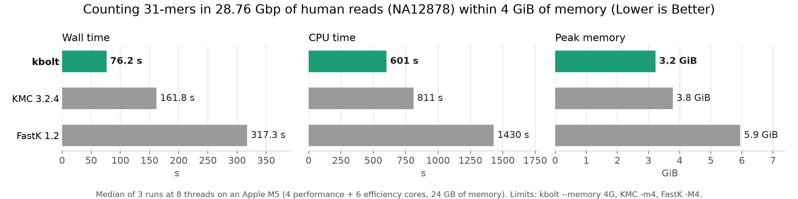
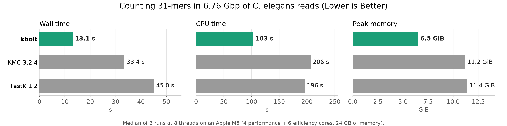

# kbolt

kbolt counts k-mers in DNA. Point it at a genome or a batch of sequencing reads
and it lists every substring of length k along with how many times it shows up.
The counts are exact, not estimates. It reads FASTA and FASTQ, gzipped or not,
and you can use it from the command line or as a Rust library.

It's built to be fast on an ordinary machine. By default it counts in memory,
and `--memory` switches to disk-backed counting when the distinct k-mers don't
fit in RAM. Here's how it compares with KMC and FastK, two widely used exact
counters, on a human read set far larger than the laptop's memory (NA12878
SRR8848156: two gzipped FASTQ files, 28.76 Gbp, 8.19 billion distinct
31-mers, which would take over 100 GB to hold in memory):



Counting canonical 31-mers at 8 threads with every tool limited to 4 GiB
(kbolt `--memory 4G`, KMC `-m4`, FastK `-M4`), median of 3 runs on an Apple M5
with 24 GB of memory:

| | Wall time | CPU time | Peak memory |
|---|---:|---:|---:|
| kbolt | **76.2 s** | 601 s | 3.2 GiB |
| KMC | 161.8 s | 811 s | 3.8 GiB |
| FastK | 317.3 s | 1430 s | 5.9 GiB |

kbolt is 2.1× faster than KMC and 4.2× faster than FastK, and stays furthest
below the limit. Its first pass, about 27 s, waits on inflating the two gzip
files, one thread per file.

On a read set whose k-mers fit in memory (C. elegans SRR065390: two gzipped
FASTQ files, 6.76 Gbp, 488 million distinct 31-mers), the margin is wider:



| | Wall time | CPU time | Peak memory |
|---|---:|---:|---:|
| kbolt | **10.5 s** | 93 s | 6.5 GiB |
| KMC | 33.6 s | 210 s | 11.0 GiB |
| FastK | 44.1 s | 197 s | 9.9 GiB |

kbolt is 3.2× faster than KMC and 4.2× faster than FastK, on less than half
the CPU time and two thirds of the memory or less. kbolt and KMC report identical counts.

The same reads with every tool limited to 2 GiB, median of 3 runs:

| | Wall time | CPU time | Peak memory |
|---|---:|---:|---:|
| kbolt | **11.7 s** | 84 s | 1.4 GiB |
| KMC | 34.4 s | 198 s | 1.9 GiB |
| FastK | 43.9 s | 192 s | 4.2 GiB |

The result is identical to counting in memory.

On smaller inputs the margin is similar or larger, here with Jellyfish as
well. Wall time (median of 3 runs):

| Workload | Threads | kbolt | FastK | KMC | Jellyfish |
|---|---:|---:|---:|---:|---:|
| Arabidopsis genome, 120 Mbp | 1 | **2.87 s** | 6.52 s | 4.12 s | 29.4 s |
|  | 8 | **0.61 s** | 2.02 s | 1.60 s | 6.61 s |
| Synthetic reads, 134 Mbp FASTQ | 1 | **0.57 s** | 2.08 s | 4.87 s | 6.29 s |
|  | 8 | **0.13 s** | 0.61 s | 1.63 s | 2.82 s |
| Same reads, gzip | 1 | **0.56 s** | 2.38 s | 4.88 s | 6.64 s |
|  | 8 | **0.20 s** | 0.81 s | 1.94 s | 2.42 s |

All four tools report identical counts on these inputs.

## Usage

```sh
cargo install --path .

kbolt count -k 31 reads.fastq.gz > counts.tsv
kbolt count -k 31 -t 8 sample_R1.fastq.gz sample_R2.fastq.gz -o counts.tsv
kbolt count -k 31 -t 8 --format binary reads.fastq.gz -o counts.kbolt
kbolt count -k 31 -t 8 --memory 4G reads.fastq.gz -o counts.tsv
kbolt dump counts.kbolt > counts.tsv
```

- Output is `KMER<TAB>COUNT` per line, in no particular order.
- Reverse complements are combined by default; `--forward` counts each strand
  separately.
- Format and compression are detected from the content. With no input files,
  kbolt reads stdin.
- `-t N` sets the number of counting threads. `--progress` and `--timings`
  report on stderr.
- By default every distinct k-mer is held in RAM. `--memory SIZE` (k ≤ 32)
  counts within about that much memory instead: the input is first split
  into bins, kept in memory up to half the limit and otherwise in a temporary
  file under `--temp-dir` (a little under a byte per input base).

See `kbolt count --help` for all options.

## Library

```rust
use kbolt::{Counter, StrandMode};

fn main() -> Result<(), kbolt::Error> {
    let mut counter = Counter::new(3, StrandMode::Canonical)?;
    counter.add_record(b"ACGT")?;
    counter.add_record(b"acg")?;

    for (kmer, count) in counter.counts() {
        println!("{} {count}", String::from_utf8_lossy(&kmer)); // ACG 3
    }
    Ok(())
}
```

For many short reads, `add_records` is faster than repeated `add_record`
calls. `ParallelCounter` counts on several threads and `finish()` returns a
normal `Counter`. `DiskCounter` takes input the same way but counts on disk
within a memory limit and writes its result straight to a file. All three also
support `add_file`, `add_files`, and `add_reader` for streaming plain or gzipped
FASTA/FASTQ input, and `Counter` supports `get`, `get_many`, `histogram`,
`top_k`, and filtered/packed export.

## Python and R bindings

Native bindings live under [`bindings/python`](bindings/python) (PyO3 + maturin,
single `abi3` wheel for Python 3.11+) and [`bindings/r`](bindings/r) (extendr).
Both keep the hash tables in Rust memory and stream FASTA/FASTQ/gzip files
directly through the Rust engine, so you can query, summarize, and filter
without materializing hundreds of millions of strings in Python or R.

### Python

```sh
cd bindings/python && maturin develop --release
```

```python
import kbolt

# Count plain or gzipped FASTA/FASTQ files in parallel (GIL released)
counts = kbolt.count_files(["sample_R1.fastq.gz", "sample_R2.fastq.gz"], k=31, threads=8)

len(counts)
counts["ACGTACGTACGTACGTACGTACGTACGTACG"]
counts.get_many(["ACGT...", "TGCA..."])

# K-mer spectrum, top-k, and bulk NumPy export (S{k} ASCII or packed uint64)
spectrum = counts.histogram()
top20 = counts.top_k(20)
keys, vals = counts.to_numpy(min_count=2, packed=True)

# Count on disk within a memory budget and stream the .kbolt database
kbolt.count_files_to_disk(
    ["sample_R1.fastq.gz", "sample_R2.fastq.gz"],
    "counts.kbolt",
    k=31,
    memory="2G",
    threads=8,
)
with kbolt.open_database("counts.kbolt") as db:
    for kmer, count in db:
        ...
```

### R

```sh
R CMD INSTALL bindings/r
```

```r
library(kbolt)

# Count plain or gzipped FASTA/FASTQ files in parallel
counts <- kbolt_count_files(c("sample_R1.fastq.gz", "sample_R2.fastq.gz"), k = 31, threads = 8)

length(counts)
counts[c("ACGTACGTACGTACGTACGTACGTACGTACG", "TTTTTTTTTTTTTTTTTTTTTTTTTTTTTTT")]

# K-mer spectrum, top-k, and filtered data.frame export
spectrum <- kbolt_histogram(counts)
top20 <- kbolt_top_k(counts, 20)
df <- as.data.frame(counts, min_count = 2)

# Count on disk within a memory budget and read chunks from the .kbolt database
kbolt_count_files_to_disk(
  c("sample_R1.fastq.gz", "sample_R2.fastq.gz"),
  output = "counts.kbolt",
  k = 31,
  memory = "2G",
  threads = 8
)
db <- kbolt_open_database("counts.kbolt")
chunk <- kbolt_database_read(db, n = 100000)
kbolt_database_close(db)
```

## How it works

For k ≤ 32, each k-mer is packed into 64 bits and passed through an invertible
hash. The top hash bits choose a partition, and the rest are stored in a single
64-bit slot alongside a small count. Rare large counts move to a side table, so
every count stays exact. Slots sit in 64-byte buckets of eight, so a lookup
touches one cache line.

With several threads there are thousands of small tables. Updates are queued
per group of tables and applied in bulk, one table at a time, so each table is
pulled into the CPU cache once and updated there instead of missing the cache
on every k-mer. Tables grow in small steps and are returned to the OS when
outgrown, which keeps memory close to what the k-mers need. Longer k-mers use
ordinary hash maps.

With `--memory`, counting takes two passes. The first cuts each read into
super-k-mers, runs of neighbouring k-mers that share a minimizer, and appends
them to one of 2048 bins; every copy of a k-mer lands in the same bin. Bins
stay in memory while the limit allows and go to a temporary file after that.
The second pass counts one bin at a time with the same tables and writes its
k-mers out before the next, so memory follows the bins being counted, not the
input. Each bin gets as many tables as its distinct k-mers need to stay in
cache, and bins still in memory are moved to the file when the tables need
the room. Reads overlap, so most super-k-mers of a read set occur many times;
equal ones are merged first and their k-mers counted once, with the number of
copies.

Gzip input is inflated on one thread per file, which would otherwise set the
pace on compressed reads, so kbolt has a streaming decoder of its own
(`src/gzip.rs`). It is built like libdeflate's: a 64-bit bit buffer, one table
lookup per symbol, and matches copied a word at a time. On the C. elegans
reads it produces 1.3 GB/s on one thread, against 1.1 GB/s for zlib.

## Development

```sh
cargo test
cargo clippy --all-targets -- -D warnings
cargo bench
```

On x86-64, the table lookup uses the widest vector instructions the build
enables: SSE2 by default, AVX2 or AVX-512 with
`RUSTFLAGS="-C target-cpu=native" cargo build --release` (or
`-C target-cpu=x86-64-v3`). A binary built that way only runs on processors
with those instructions.

`python3 benches/reads.py --tools kbolt kmc fastk` reruns the real-read
comparison after `python3 benches/reads.py --fetch` has downloaded the reads
(5 GB); FastK comes from Homebrew and KMC from its GitHub releases. Add
`--memory 0 2` to also run every tool with a 2 GiB limit. Redraw the
chart with `uv run --no-project --with matplotlib python benches/plot_reads.py`.
`--dataset na12878` does the same for the human reads (16 GB to download);
`python3 benches/reads.py --dataset na12878 --memory 4 --tools kbolt kmc fastk
--warmup 0` reruns the comparison above, and `benches/plot_reads.py --results
target/compare/reads-results.json --output docs/benchmark-human.png` redraws
its chart.
`python3 benches/compare.py` reruns the small-input comparison (inputs from
`benches/generate_inputs.py`), and `benches/plot_compare.py` plots its
throughput against threads.
