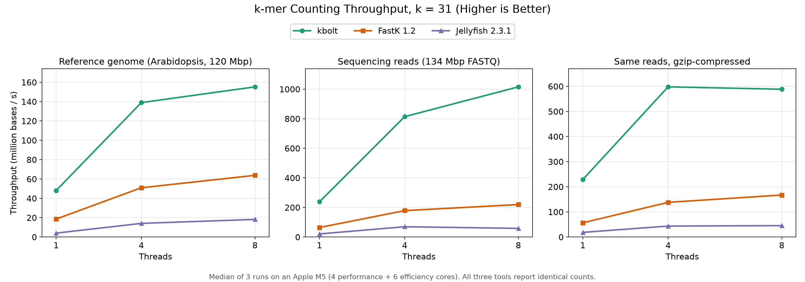

# kbolt

kbolt counts k-mers in DNA. Point it at a genome or a batch of sequencing reads
and it lists every substring of length k along with how many times it shows up.
The counts are exact, not estimates. It reads FASTA and FASTQ, gzipped or not,
and you can use it from the command line or as a Rust library.

It's built to be fast on an ordinary machine. Everything stays in memory, so it
works best when the distinct k-mers fit in RAM. Here's how it compares with
FastK and Jellyfish, two widely used exact counters, on the same inputs:



Wall time to count canonical 31-mers (median of 3 runs, Apple M5):

| Workload | Threads | kbolt | FastK | Jellyfish |
|---|---:|---:|---:|---:|
| Arabidopsis genome, 120 Mbp | 1 | **2.49 s** | 6.45 s | 29.8 s |
|  | 8 | **0.77 s** | 1.88 s | 6.57 s |
| Reads, 134 Mbp FASTQ | 1 | **0.56 s** | 2.09 s | 6.46 s |
|  | 8 | **0.13 s** | 0.61 s | 2.30 s |
| Same reads, gzip | 1 | **0.59 s** | 2.37 s | 7.29 s |
|  | 8 | **0.23 s** | 0.80 s | 2.96 s |

kbolt is 2.4–4.6× faster than FastK and 8.5–17× faster than Jellyfish here,
and all three report identical counts.

## Usage

```sh
cargo install --path .

kbolt count -k 31 reads.fastq.gz > counts.tsv
kbolt count -k 31 -t 8 sample_R1.fastq.gz sample_R2.fastq.gz -o counts.tsv
kbolt count -k 31 -t 8 --format binary reads.fastq.gz -o counts.kbolt
kbolt dump counts.kbolt > counts.tsv
```

- Output is `KMER<TAB>COUNT` per line, in no particular order.
- Reverse complements are combined by default; `--forward` counts each strand
  separately.
- Format and compression are detected from the content. With no input files,
  kbolt reads stdin.
- `-t N` sets the number of counting threads. `--progress` and `--timings`
  report on stderr.
- Every distinct k-mer is held in RAM; there is no disk spill.

See `kbolt count --help` for all options.

## Library

```rust
use kbolt::{Counter, StrandMode};

fn main() -> Result<(), kbolt::Error> {
    let mut counter = Counter::new(3, StrandMode::Canonical)?;
    counter.add_record(b"ACGT")?;
    counter.add_record(b"acg")?;

    for (kmer, count) in counter.counts() {
        println!("{} {count}", String::from_utf8_lossy(&kmer)); // ACG 3
    }
    Ok(())
}
```

For many short reads, `add_records` is faster than repeated `add_record`
calls. `ParallelCounter` counts on several threads and `finish()` returns a
normal `Counter`.

## How it works

For k ≤ 32, each k-mer is packed into 64 bits and passed through an invertible
hash. The top hash bits choose a partition, and the rest are stored in a single
64-bit slot alongside a small count. Rare large counts move to a side table, so
every count stays exact. Slots sit in 64-byte buckets of eight, so a lookup
touches one cache line, and updates are buffered so buckets can be prefetched
ahead of time. Longer k-mers use ordinary hash maps.

## Development

```sh
cargo test
cargo clippy --all-targets -- -D warnings
cargo bench
```

`python3 benches/compare.py` reruns the comparison (FastK and Jellyfish from
Homebrew, inputs from `benches/generate_inputs.py`). Redraw the chart with
`uv run --no-project --with matplotlib python benches/plot_compare.py`.
